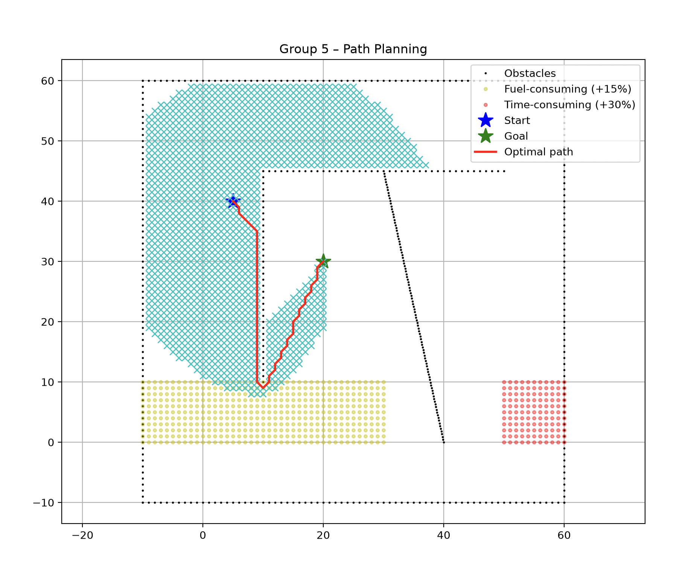
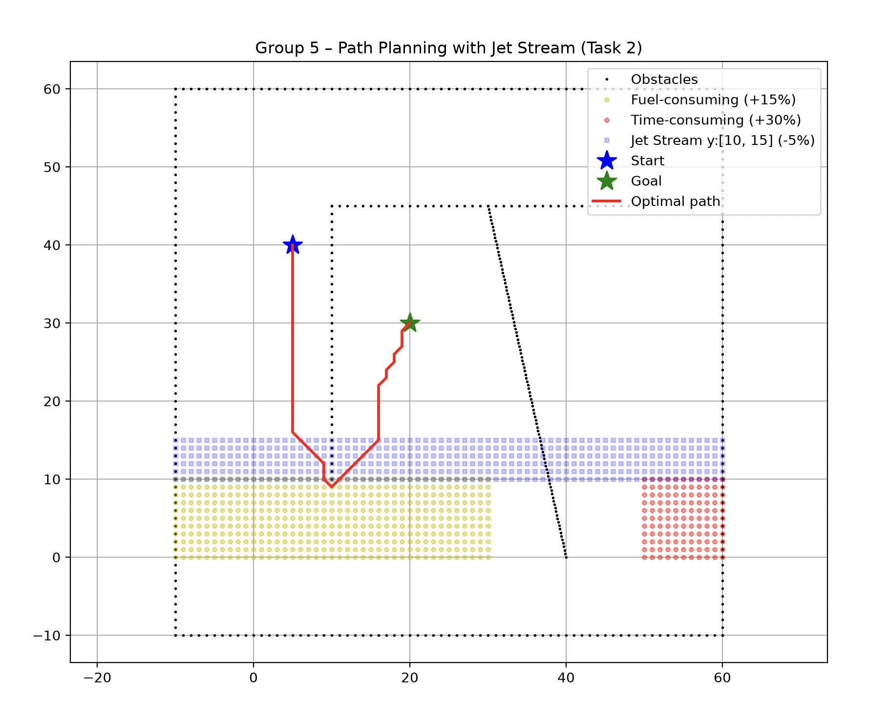
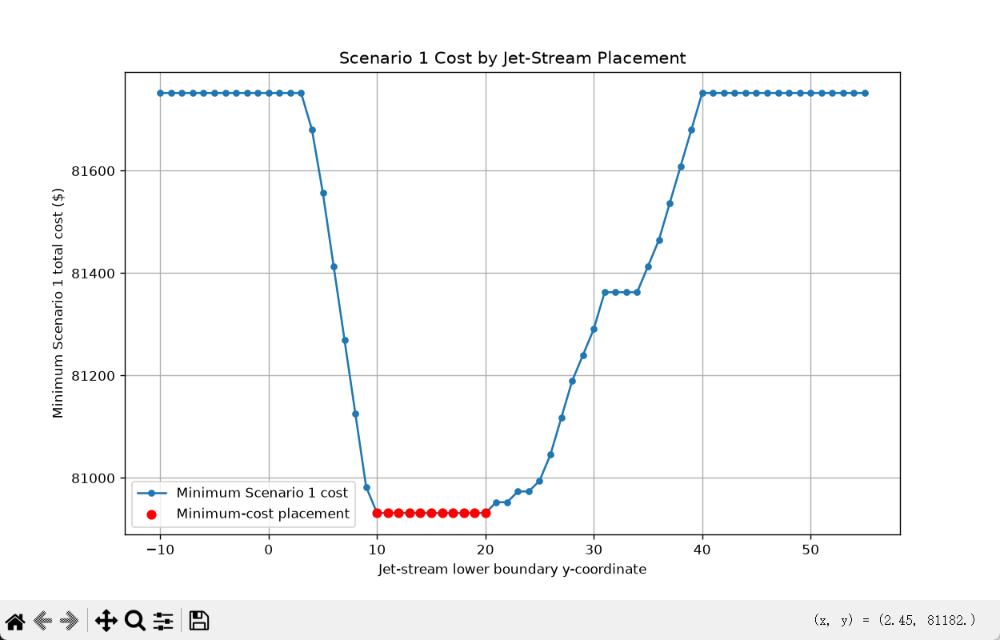
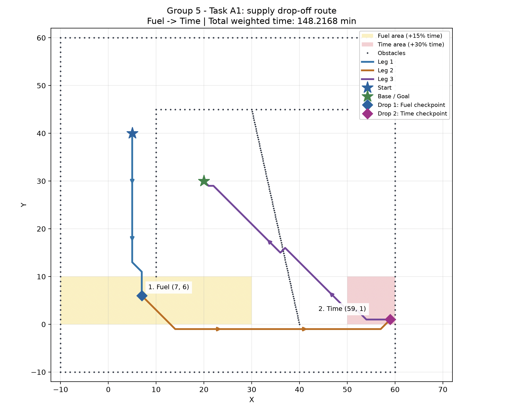
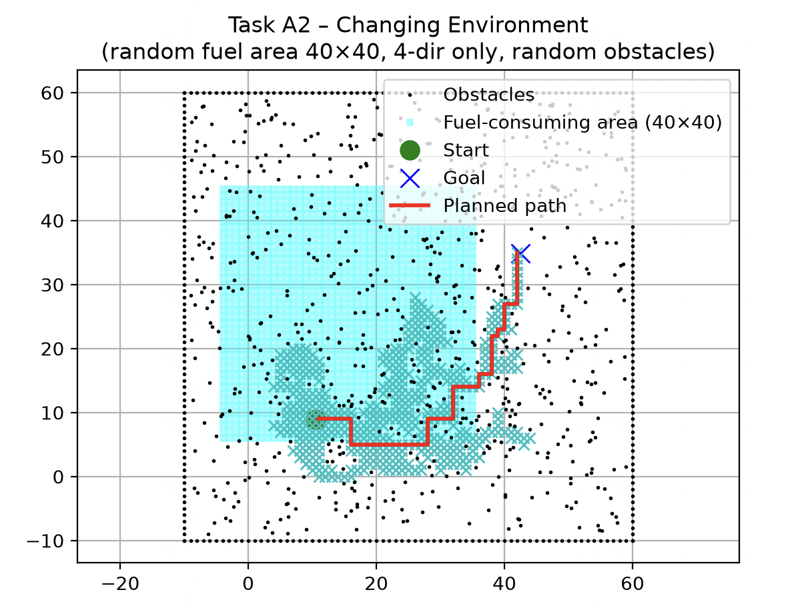
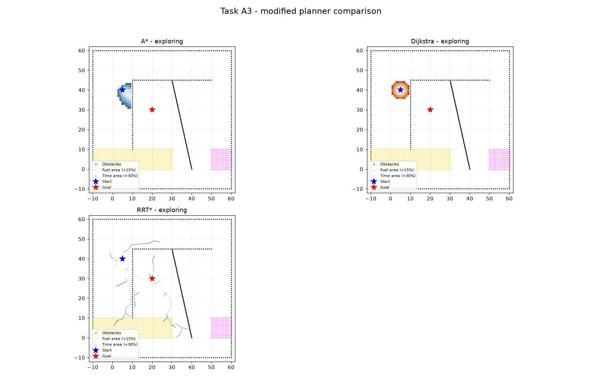
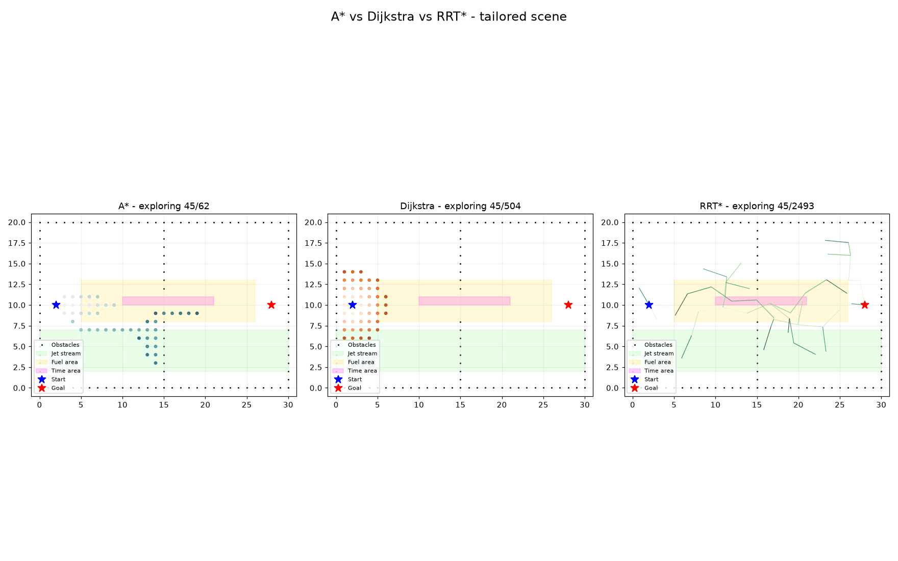
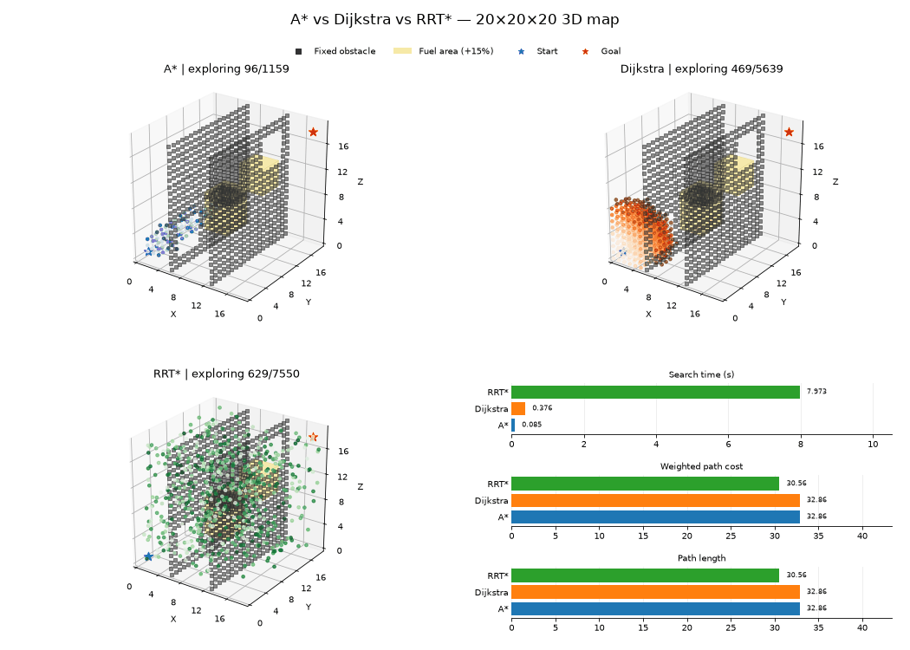

<h1 align="center">AAE1001 Group 5 Project</h1>
<p align="center">Aircraft Route Planning and Operating Costs · 2026/27 Semester 1</p>

## Project Overview

<!-- 这里是首页简介。每题用一句话，让读者快速看懂项目范围。 -->

Group 5 studies aircraft routing and operating costs through six tasks.

- **Task 1** finds the fastest route with A* and compares aircraft costs across three scenarios.
- **Task 2** investigates where to place a jet stream to reduce operating costs.
- **Task 3** compares aircraft capacities and engine requirements for Scenario 1.
- **Task A1** plans a route through two supply checkpoints.
- **Task A2** plans a route in a randomly generated environment.
- **Task A3** compares A*, Dijkstra, and RRT*.

<details open>
<summary><strong>Table of Contents</strong></summary>

1. [Project Overview](#project-overview)
   - [Repository Layout](#repository-layout)
2. [Task 1](#task-1)
3. [Task 2](#task-2)
4. [Task 3](#task-3)
5. [Task A1](#task-a1)
6. [Task A2](#task-a2)
7. [Task A3](#task-a3)
8. [How to Run](#how-to-run)
9. [Team Members and Contributions](#team-members-and-contributions)
10. [References](#references)
11. [Individual Reflections](#individual-reflections)

</details>

<!-- 目录链接与下方标题对应。若改标题，记得同步修改目录中的 # 跳转链接。 -->

## Repository Layout

| Folder | Contents |
|---|---|
| [Task1](./Task1/) | Regular Task 1 route planning, aircraft cost calculation, and related figures. |
| [Task2](./Task2/) | Jet-stream programs, draft and final versions, automated placement comparison, and related results. |
| [Task3](./Task3/) | Aircraft-capacity and operating-cost design program. |
| [TaskA1](./TaskA1/) | Checkpoint planner, route figures, and saved results. |
| [TaskA2](./TaskA2/) | Random environment planner and route figure. |
| [TaskA3](./TaskA3/) | Algorithm comparison programs, tailored scene, figures, and animations. |
| [Archive](./Archive/) | The existing image marked “DO NOT USE”, retained for completeness. |

A1, A2 and A3 extend the route-planning work and each has its own folder. The contribution table and individual reflections remain in this README.

## Task 1

### A* Route Planning and Aircraft Selection

A* searches an eight-direction grid from (5, 40) to (20, 30). The route avoids obstacles and accounts for the 15% and 30% cost increases in the two designated regions. For each passenger scenario, the aircraft comparison screens out options that exceed the flight limit and ranks the remaining options by total operating cost.



*Task 1 baseline route without a jet stream.*

<!-- 从正式输出填入三个场景的最终结果。总成本是整个场景的费用。表后用一句话说明胜出机型，并列出超出班次上限的机型。 -->

<!-- UPDATE T1: verified scenario results and current model assumptions. | README line 48. -->

| Scenario | Passengers | Flight limit | Fuel price ($/kg) | Selected aircraft | Flights | Total cost ($) |
|---|---:|---:|---:|---|---:|---:|
| 1 | 3,300 | 13 | 0.85 | A330-900neo | 11 | 81,751.58 |
| 2 | 1,500 | 7 | 0.96 | A330-900neo | 5 | 41,639.42 |
| 3 | 2,250 | 25 | 0.78 | A330-900neo | 8 | 53,868.54 |

The current `Task1_Final.py` returns a weighted route time of **58.7875 minutes**. A330-900neo has the lowest total cost in all three scenarios. A321neo requires 17 flights in Scenario 1 and 8 flights in Scenario 2, exceeding the respective limits; all three aircraft are feasible in Scenario 3.

[View the Task 1 terminal output for all three scenarios](./Task1/Figure2_Task1%20Terminal%20Output.png).

The calculation uses `N = ceil(passengers / capacity)` and `total_cost = N * (fuel_price * fuel_rate * T_best + C_T * T_best + C_c)`. Totals use the unrounded route time and are rounded only for display.

**Current implementation assumptions:** cardinal moves cost 1 and diagonal moves cost `sqrt(2)`. Entering the fuel/time regions adds 15%/30% to the same weighted route cost, which is then used as `T_best` for both fuel and time charges. These are results of the current code. The lecture specifies 2 minutes for diagonal moves; this difference, and the treatment of fuel penalties as weighted time, should be resolved before claiming full compliance.

## Task 2

### Jet Stream Placement

[Task2_Modified.py](./Task2/Task2_Modified.py) tests all 66 integer lower boundaries from `y = -10` to `y = 55` for a horizontal jet stream five units high. For each placement, it runs A* on the Group 5 map and estimates Scenario 1 operating cost for 11 A330-900neo flights. The jet stream reduces the base cost of a move by 5% when its destination cell lies within the band. The fuel and time surcharges are added separately.

| Jet stream placement | Weighted route time (min) | Scenario 1 total cost ($) |
|---|---:|---:|
| No jet stream (Task 1 baseline) | 58.7875 | 81,751.58 |
| **Selected lower boundary `y = 10` (band `[10, 15]`)** | **57.9804** | **80,931.24** |

The integer lower boundaries from **10 through 20** tie for the lowest cost found. The script uses the first tied placement, `y = 10`, for the route plot. It saves approximately **$820.34 (1.00%)** relative to the no-jet-stream baseline. The sweep covers the integer placements in the script. Since A* still uses an unscaled distance heuristic with discounted moves, these results describe the best route and placement the implementation found.

Running the script opens two figures: Scenario 1 cost by lower boundary and the route for the selected band.



*Task 2 route at the first minimum-cost placement in the sweep.*



*Scenario 1 minimum operating cost across the tested jet-stream placements.*

## Task 3

### New Aircraft Design

The design must carry 3,300 passengers in at most 13 flights. Candidate capacities range from 100 to 450 seats in steps of 50. Capacities below 300 seats use two engines, and capacities from 300 seats onward use four. The model compares fuel, time, and fixed costs.

<!-- 用 Task3_Final.py 核对各座位档位。填每班三类费用与总成本，在表下写最终机名、座位数、发动机数和班次，并说明为什么选它。 -->

<!-- UPDATE T3: cost breakdown verified against Task3_Final.py; comparison with Task 1 baseline. | README line 93. -->

| Seats | Flights required | Engines | Fuel per flight ($) | Time per flight ($) | Fixed per flight ($) | Total cost ($) |
|---:|---:|---:|---:|---:|---:|---:|
| 100–250 | Over 13 | 2 | — | — | — | Infeasible |
| 300 | 11 | 4 | 3,997.55 | 1,175.75 | 2,500.00 | 84,406.30 |
| 350 | 10 | 4 | 3,997.55 | 1,293.33 | 2,500.00 | 77,908.75 |
| 400 | 9 | 4 | 3,997.55 | 1,410.90 | 2,500.00 | 71,176.05 |
| **450** | **8** | **4** | **3,997.55** | **1,528.48** | **2,500.00** | **64,208.20** |

The selected design is **doeing 7700: 450 seats, four engines and eight flights**. It provides 3,600 seats for 3,300 passengers and stays within the 13-flight limit. Capacities of 100, 150, 200 and 250 require 33, 22, 17 and 14 flights respectively and are infeasible.

The script uses `C_T = 12 + 2 * ((seats - 100) // 50)`, so 100 seats correspond to $12/min. It fixes `T_best = 58.7875` minutes rather than importing Task 1 output. Four engines consume 80 kg/min, giving 4,703 kg of fuel per flight at $0.85/kg. Costs are calculated before rounding the displayed components.

Compared with the 300-seat candidate, the selected design saves **$20,198.10 (23.93%)**. Compared with Task 1 Scenario 1's selected A330-900neo, it saves approximately **$17,543.38 (21.46%)** under the current model. These comparisons inherit the Task 1 assumptions described above.

<!-- 如果 PPT 有成本对比图，把 PNG 放进仓库，例如 figures/task3-cost.png，再在这里加一行 。 -->

## Task A1

### Supply Checkpoints

The planner generates one checkpoint in each cost region. It compares the two possible visit orders and selects the reachable order with the lower weighted travel time.

<!-- UPDATE A1: reproducible checkpoint results and existing output options. | README line 119. -->

With the default `--seed 5`, the fuel checkpoint is **(7, 6)** and the time checkpoint is **(59, 1)**.

| Visit order | Total weighted travel time (min) |
|---|---:|
| Start -> Fuel -> Time -> Base | **148.2168** |
| Start -> Time -> Fuel -> Base | 178.0319 |

The selected order visits Fuel first and Time second, reducing weighted time by **29.8151 minutes** relative to the other order. The script checks that both checkpoints are visited and that the base is not reached earlier. By default it saves `TaskA1/A1_results/A1_route.png` and `TaskA1/A1_results/A1_route.txt`; `--output` changes the output path.



*Task A1 with seed 5: fuel checkpoint first, then time checkpoint, for a total weighted time of 148.2168 minutes.*

## Task A2

### Randomized Environment

The program generates a 40 × 40 fuel-cost region, random obstacles, and endpoints at least 40 units apart. The planner moves in four directions.



*Task A2 route from a separate run. The seed 5 example below uses different start and goal positions.*

<!-- UPDATE A2: code parameters and a seeded verification example. | README line 138. -->

The main program uses map bounds `[-10, 60]`, grid resolution 1, robot radius 1 and `obstacle_density=0.15`. This density controls the number of sampled obstacle candidates, not the exact final occupied-cell fraction. Candidates within 4 units of either endpoint are skipped. The minimum sampled start-goal distance is 40 units. Entering the fuel region adds 50% to movement cost.

The script does not set a random seed. For a reproducible verification example, we set Python's global random seed to 5 immediately before calling the unchanged `main()` function:

| Item | Verified example |
|---|---|
| Start (rounded for display) | (39.4, 50.3) |
| Goal (rounded for display) | (-3.3, 22.9) |
| Sampled start-goal distance | 50.7 units |
| Weighted route cost | 98.00 |

These values describe the seeded example, not every ordinary run. The current no-path branch breaks out of the search and still reconstructs a goal-only path; failure handling should be corrected before using it to measure success rates.

## Task A3

### A*, Dijkstra, and RRT*

[TaskA3_Compare_Modified.py](./TaskA3/TaskA3_Compare_Modified.py) runs A*, Dijkstra and RRT* with the same obstacles, cost regions, start **(5, 40)** and goal **(20, 30)**. The jet-stream discount is disabled for this comparison. The figure shows the search progress and final route for each algorithm, alongside charts for elapsed time, shared route score and estimated Scenario 1 operating cost.

The planners use their own cost calculations during search. After each search, the script samples the returned route in segments of at most half a grid unit and applies the same regional surcharges for all three planners. It then uses that shared score to estimate Scenario 1 operating cost and select the lowest-cost aircraft within the flight limit.

| Algorithm | Elapsed time (s) | Shared route score (weighted min) | Path length (map units) | Scenario 1 total cost ($) |
|---|---:|---:|---:|---:|
| A* | 5.04 | 58.79 | 58.2 | 81,752 |
| Dijkstra | 5.84 | 58.79 | 58.2 | 81,752 |
| RRT* (seed 0, 5,000 iterations) | 10.21 | 58.79 | 58.2 | 81,752 |

In the run shown, all three routes have the same displayed shared score and length, and each selects **11 A330-900neo flights**. The displayed times include refreshing the plot during search, so they can vary by machine.


*Task A3 comparison on the same obstacle map. The elapsed times shown are from the run captured in the figure.*


*Task A3 final results.*


### Additional A3: Tailored-2D-Scene Comparison

The previous comparison evaluates A*, Dijkstra and RRT* on the same original map. However it can't comprehensively compare their advantages and disadvantafes. This additional experiment uses a tailored scene to compare their routes and costs under a different obstacle layout. The start is **(2, 10)** and the goal is **(28, 10)**. A vertical wall at `x = 15` leaves a narrow passage around `y = 9–11`. The scene also includes a jet stream, a fuel-cost region and a time-cost region.

The additional script, [`taskA3_additional`](./TaskA3/taskA3_additional), imports the planner implementations from [`TaskA3_Compare_Modified.py`](./TaskA3/TaskA3_Compare_Modified.py). Both files are kept together in `TaskA3/`. Run the additional comparison from the repository root with `python TaskA3/taskA3_additional`.


*Task A3 comparison on the the tailered map. The elapsed times shown are from the run captured in the figure.*


*Task A3 additional final results.*


The shared route score applies the fuel and time region surcharges to each returned route. The current shared scoring function does not include the jet-stream discount; A* does use that discount during its search.

| Algorithm | Elapsed time (ms) | Shared route score (weighted min) | Path length (map units) | Scenario 1 total cost ($) |
|---|---:|---:|---:|---:|
| A* | 0.92 | 33.1260 | 32.4853 | 55,669.23 |
| Dijkstra | 3.02 | 29.9784 | 26.8284 | 52,470.07 |
| RRT* (seed 0, 5,000 iterations) | 1,214.37 | 29.9698 | 26.8284 | 52,461.35 |

In this run, RRT* finds the shortest way with a much longer time,while Dijkstra find a similar way in much shorter time. A* finds a longer way than them, but with the shortest time. This test illustrate that RRT* is suitable for finding the shortest way in a complex and dynamic scenario, but it also requires higher  computational power.Dijkstra perfers best comprehensively in this scenario,since it find a way with acceptable tolerance and use much shorter time. And A* may not be suitable for finding the perfect shortest way in such a complex scenario.

## Additional A3: 3D scenario

### A*, Dijkstra, and RRT*

[TaskA3_Compare_Modified.py](./TaskA3/TaskA3_Compare_Modified.py) and [`taskA3_additional`](./TaskA3/taskA3_additional) only conpare the 3 algorithisms in 2D scenarios. To compare theim capability in higher dimension space, we designed this 3D comparison task:[TaskA3_3D_compare.py](./TaskA3/TaskA3_3D_compare.py) This task runs A*, Dijkstra and RRT* with the same map, its details are as follows:

1.start **(1,1,1)** and goal **(18,18,18)**. 

2.Obstacles.

Wall at x = 6, spanning y,z = 0–19, with an opening at y,z = 2–6.

Wall at x = 13, spanning y,z = 0–19, with an opening at y,z = 13–17.

Central block: x,y,z = 8–10.

Flat XY obstacle: z = 9, spanning x,y = 7–11.

3.Fuel areas(15% weighted)

x = 7–10, y = 8–12, z = 4–9

x = 13–16, y = 8–11, z = 12–15

the results are as follows:


| Algorithm | Elapsed time (s) | weighted path cost | Path length (map units) | 
|---|---:|---:|---:|
| A* | 0.085 | 30.56| 30.56| 
| Dijkstra | 0.376 | 32.86 | 32.86| 
| RRT* (seed 10,000 iterations) | 7973 | 32.86 | 32.86 | 

note:since the route did not pass the fuel area, so the costs are be in direct proportion to the length.

In the run shown, RRT* finds the shortest route of 30.56 units with an extremely long runtime of 7973s.Dijkstra and A* finds a longer route of 32.86 units in 0.376s and 0.085s.


*Task A3 comparison on the same 3D obstacle map. *
The runtime of RRT* in 3D scenario is roughly 100,000 times longer than other 2 algrothism, while in A3_additional its 1000times, in A3 its 2 times. This illustrates that with the complexoty of scenario increased, the runtime gap between RRT* and other 2 algorithms incrases in exponential level.
Also, with the increase of scenario complexity, RRT* performs a better optimality than the other 2 algorithms


## How to Run

<!-- 提交前核对依赖、文件名和命令。若脚本改名，同时更新本节和 References。 -->

Run the commands below from the repository root with Python 3. Install Matplotlib and NumPy:

```bash
python -m pip install "matplotlib>=3.10" numpy
```

| Task | Source file | Command |
|---|---|---|
| 1 | [Task1_Final.py](./Task1/Task1_Final.py) | `python Task1/Task1_Final.py` |
| 2 | [Task2_Modified.py](./Task2/Task2_Modified.py) | `python Task2/Task2_Modified.py` |
| 3 | [Task3_Final.py](./Task3/Task3_Final.py) | `python Task3/Task3_Final.py` |
| A1 | [TaskA1_Final.py](./TaskA1/TaskA1_Final.py) | `python TaskA1/TaskA1_Final.py --no-show` |
| A2 | [TaskA2_Final.py](./TaskA2/TaskA2_Final.py) | `python TaskA2/TaskA2_Final.py` |
| A3 | [TaskA3_Compare_Modified.py](./TaskA3/TaskA3_Compare_Modified.py) | `python TaskA3/TaskA3_Compare_Modified.py` |
| A3 | [TaskA3_additional.py](./TaskA3/taskA3_additional) | `python TaskA3/TaskA3_additional` |
| A3 | [TaskA3_3D_compare.py](./TaskA3/cTaskA3/TaskA3_3D_compare.py) | `python TaskA3/TaskA3_3D_compare.py` |

Task 2 shows the sweep table in the terminal and opens two plots. Close both plots to see the final aircraft cost breakdown. For the A3 comparison, wait for `Comparison complete` in the terminal, then close the figure to exit. To run the A3 planners individually, use `python TaskA3/TaskA3.1_Final.py` for Dijkstra or `python TaskA3/TaskA3.2_Final.py` for RRT*.

Task 3 repeatedly asks for a capacity. Use 300, 350, 400 or 450 for feasible designs and press Ctrl+C to stop.

For Task A1, use the existing command-line options:

```bash
python TaskA1/TaskA1_Final.py --seed 5 --no-show --output TaskA1/A1_results/A1_route.png
```

To reproduce the A2 seeded example without changing its source:

```bash
python -c 'import random, runpy; random.seed(5); runpy.run_path("TaskA2/TaskA2_Final.py", run_name="__main__")'
```

## Team Members and Contributions

<!-- 保留了草稿中的八行。填真实姓名和实际分工。学号只按课程要求填写。 -->

<!-- UPDATE TEAM: identities and individual allocations still require team confirmation; no details invented. | README line 214. -->

| Name | GitHub Nickname | Student ID | Contribution |
|---|---|---|---|
| YUYI(Louis) LIU | Lyuyiiii | 26125637D | I completed Task A1 with ChatGPT's help, created the Task 1 presentation, helped clarify the Task 2 requirements, and revised the cost calculations and flight constraints in a teammate’s Task 3 code. |
| Romeo | OreoLaw | 26088558D | Refined the programs for all tasks and tailored the aircraft design approach |
| Sahil | a1rrr368 | 26127898D | Wrote the code that helped do the calculations for Task 3, helped check the best approaches with the jet stream with teammates in Task 2, and developed presentation slides for Task A3 |
| Li Wai Fung | Li-Wai-Fung | 24082728D | Revised the draft code of Task 1 to clear out some errors, completed Task A2 with the help of ChatGPT and made the presentation slides for the task. |
|CHEN Lingxi| Lingxi-123-lab |26107016D| I completed and clarify the Task 2 ,completed the 2 algrothism of Task A3.I also helped to clearify the design of our aircraft in Task3 |
| LOI Chi Wun | LoiCW3 | 26121716D | I ran the tests for Task A1, gathered two maps with both visiting orders, and finished the presentation slides for Task A1. |
| Cai Xintong Michelle | MichelleCai32 | 26138185D | I completed Task 2 slides and organized the comparison of flight time and operating costs. Calculated and presented cost savings and percentage reductions for the aircraft options. |
| Sama | sama26052605 | 26126077D | I modified the initial draft of A* path planning program and cost models in T1, collaborated on jet stream and passenger capacity optimization in T2&3, and prepared the final presentation slides covering intro to path planning and overview for the project and each task. |

## References

<!-- 补上实际借鉴的 Dijkstra、RRT* 原始 GitHub 文件链接。若图片来自外部，也在这里注明出处。 -->

- [AAE1001 course repository](https://github.com/RNS-Lab-PolyU/PolyU_AAE1001_Github_Project_2026)

<!-- UPDATE SOURCES: direct implementation links; external algorithm provenance still to be supplied by authors. | README line 233. -->

Project implementations:

- [Task 1: A* and scenario costs](./Task1/Task1_Final.py)
- [Task 2: jet-stream placement sweep](./Task2/Task2_Modified.py)
- [Task 3: aircraft capacity and costs](./Task3/Task3_Final.py)
- [Task A1: checkpoint orders](./TaskA1/TaskA1_Final.py)
- [Task A2: random environment](./TaskA2/TaskA2_Final.py)
- [Task A3: three-planner comparison](./TaskA3/TaskA3_Compare_Modified.py)
- [Task A3.1: Dijkstra](./TaskA3/TaskA3.1_Final.py)
- [Task A3.2: RRT*](./TaskA3/TaskA3.2_Final.py)

## Individual Reflections

<details>
<summary><strong>Louis</strong></summary>

I developed Task A1 with ChatGPT's help and created the presentation slides for Task 1. I also helped the group interpret the requirements for Task 2, revised a teammate’s implementation for Task 3, and organized the project README.

Creating the Task 1 slides taught me to explain the route-planning method and aircraft selection in a sequence the audience could follow. I applied the same idea to the README by organizing the report by task. Across these contributions, I learned that a result is easier to understand and verify when the assumptions, method, and evidence have clear logic.

For Task 2, my role was to clarify the requirements and help plan the comparison. I helped define what we needed to compare across jet stream placements, including route time and total operating cost for Scenario 1. For Task 3, I built on my teammate’s code by correcting parts of the cost calculation and checking the flight limit, which helped me understand how seating capacity affects both the number of flights and the total cost.

For Task A1, I wrote the planner to generate one checkpoint in each cost region and visit both before reaching the destination. I compared the two possible visit orders using the total weighted travel time. Using a fixed random seed made the example reproducible, which helped me check the route and explain why the planner chose that order.

</details>

<details>
<summary><strong>Romeo</strong></summary>

<!-- UPDATE ROMEO: approved reflection including program improvements. -->

I contributed to Task 3 by checking the minimum feasible passenger capacity. Transporting 3,300 passengers within 13 flights requires approximately 254 seats per flight. Since capacities increase in steps of 50, 300 seats was the smallest feasible option; 250 seats would require 14 flights. This helped the team focus on the 300-, 350-, 400- and 450-seat designs. Under the assignment rules, all these options required four engines, establishing the fuel consumption rate and fixed cost for our comparisons.

I also prepared the PowerPoint slides introducing Doeing 7700, edited its introduction, and supplemented the README to explain our design reasoning. In addition, I helped improve and modify the Task 1, Task 2 and Task 3 programs to make them more efficient and check their correctness. This included reducing repeated calculations and event registration, improving region checks, and clarifying comments. I compared outputs before and after the changes to confirm that the routes and operating costs remained unchanged.

This assignment taught me to check constraints before comparing costs and to consider capacity, flight frequency and operating costs together. Improving the programs also showed me that faster execution must be supported by verification, rather than assumed to produce correct results. Explaining our work through the PowerPoint and README strengthened my confidence in communicating numerical reasoning. I learned that calculations and documentation can both help a team make better decisions. In future projects, I would record assumptions earlier and verify changes systematically before sharing them.

</details>

<details>
<summary><strong>Sahil</strong></summary>

In Task 2, a teammate created the code which implemented the jetstream area into the map, to which me and other teammates helped find what was the ideal position to place the jetstream to output the lowest cost.

For Task 3, our objective was to find the ideal plane load that would adhere to scenario 1's requirements, while also keeping costs to a minimum, we had to choose how much passengers to have in increments of 50, and if we exceeded 300 passengers, we would require 4 engines. All these variables added onto the formula given to us by the task itself ( C = (Cf . dF . Tbest) + (Ct . Tbest . Cc) ). I designed a program that did the calculations from the given formula based on our input of passenger load, allowing us to find the ideal load with ease.

Finally I was tasked with creating the presentation slides for Task A3, which was the comparison of two other search algorithms and the A* planner. I conducted research on the two chosen search algorithms and gave a brief explanation on each, also listing their main strength and disadvantage. At the end I also compared the total cost estimated from all three algorithms, and their respective runtimes. 

Ultimately, this project bridged the gap between theoretical aeronautics and computational problem-solving. By automating cost formulas and analyzing environmental variables like jetstreams, I learned how to translate strict operational constraints into efficient programmatic solutions. Furthermore, comparing the A* planner against other search algorithms sharpened my ability to critically evaluate technical approaches, specifically balancing computational runtime against optimization outcomes. Moving forward, the ability to build automated mathematical models and analytically present complex data will be invaluable for tackling advanced aircraft performance analysis, flight routing, and systems design.

</details>

<details>
<summary><strong>Justin</strong></summary>
   
In Task 1, I discovered some errors in our draft code when I tried to run it in Jupyter Notebook. I used ChatGPT to find out the key problem of the code and asked it to suggest some ways for solving the errors. Finally, I fix the issue and revised the code.

In Task A2, I modified the path-planning code so that the environment and mission change randomly for every trial. The main updates included generating a fixed 40×40 fuel area at a random location, disabling diagonal movement so the vehicle can only move in four directions, and randomly placing the start and goal points with a minimum distance of 40 units between them.

I also generated obstacles with a reasonable density while adding a clearance zone around the start and goal to prevent immediate blockage. The plotting order was adjusted so the fuel area does not cover the obstacles.

The main challenges were balancing obstacle density and ensuring the random start/goal pair always left enough free space for a valid path. Through several testing, I learned the importance of carefully ordered random generation and geometric constraints.

Overall, these tasks improved my understanding of how to create more realistic and flexible simulation environments for path planning.

<!-- 把 Member 4 换成你的姓名。在这里粘贴 200–250 词英文反思，写清实际分工、遇到的问题、怎么处理和学到了什么。正文前后留空行。 -->

</details>

<details>
<summary><strong>Sama</strong></summary>
 In Task 1, I worked on modifying the path planning program (A* code) to make it compatible with our assigned task. I modified the routing script to navigate around obstacles and penalty zones, outputting accurate value for the best path from the start node to the end node. Afterwards, I collaborated with my peers in class to evaluate the overall operational cost using the formula provided, factoring in aircraft performance metrics such as fuel consumption rate, passenger capacity, fixed costs, and variable time-related costs. 

In Task 2, I collaborated with my teammates in class to figure out the ideal position to place the new jet stream that aims to reduce the overall trip cost. 

In Task 3, I worked with a peer to modify the program so that it can provide us with the total cost based on the input provided (number of passengers). That helped us easily identify the cost, ideal load, and suitable aircraft design based on scenario 1. 

Finally, I was assigned to prepare slides for our final presentation where I would explain our project's main objective and an overview for each task of the 3 core tasks and 3 additional tasks. Moreover, I prepared slides that present the introduction to path planning, cost intensive area, and total cost formula that was used on most of the programs that we modified. 

Overall, this project introduced me to factors that must be considered while making decisions that aim to reduce cost and increase efficiency. Additionally, it helped me understand concepts in the field of aviation and how they manage to solve problems by generating solutions where computational logic must align with real-world applicability. I also learned how to collaborate with peers on the GitHub platform to build solutions.  

<!-- 把 Member 5 换成你的姓名。在这里粘贴 200–250 词英文反思，写清实际分工、遇到的问题、怎么处理和学到了什么。正文前后留空行。 -->

</details>

<details> <summary><strong>CHEN Lingxi</strong></summary>
I mainly worked on Task 2 and Task A3, while also modifying some of the other tasks. 

For Task 2, I helped implement and evaluate different jet-stream positions. We initially assumed that placing the jet stream at (y=5) was best. I changed the experiment to test all integer positions in the specified range. The lowest Scenario 1 cost was $80,931.24, with the jet stream starting at (y=10) and covering (y=10) to (y=15). Compared with the Task 1 baseline of $81,751.58, this represents a saving of $820.34, or about 0.719%.

For Task A3, I implemented Dijkstra and RRT* and compared them with A* in two scenarios. In the original scenario, from (5, 40) to (20, 30), all three algorithms achieved a shortest distance of 58.7875 units. To make the comparison fair, I allowed RRT* to explore in continuous directions and then refined its route to use eight-direction movement.Some sources suggest that RRT* can perform well in high-dimensional or complex scenarios. To explore this, I also tested a tailored complex 2D scene with a wall, a narrow passage between (2, 10) and (28, 10), and fuel, time, and jet-stream regions.  Also, I futher compared them in a tailered 3 dimensional scenario with obstacles, fuel area.

These 3 tests helped me form a more balanced view of the algorithms. A* uses a heuristic to guide the search and can be efficient, but may sacrifice optimality. Dijkstra may be better in potimilaty, but may explore more nodes and take longer. With the increase of scenario complexity, both RRT* 's advantage in optimality and disadvantage in runtime are futher illustrated. RRT*uses random sampling to explore complex spaces, but its final route needs to be smoothed. This taught me to test algorithms in different scenarios and account for differences in scoring methods and algorithm designs, rather than treating one run as a universal ranking.

Overall, this group project gave me an opportunity to start coding with the help of AI and strengthened my teamwork skills.
</details>

<details>
<summary><strong>LOI Chi Wun</strong></summary>

For our AAE1001 group project, I focused on the testing, map analysis, and presentation slides for Task A1 (Adding a Checkpoint).

I ran different test runs to make sure everything worked properly against the task rules. I checked that the checkpoints are actually generated inside both cost-intensive areas and that the aircraft reaches both spots before flying back to base. Because there are two different orders the aircraft can take to visit the drop-off points, I ran simulations for both sequences and saved the two output maps. Putting the two plots side by side made it really clear how the visiting order changed the flight path and total distance. I also double-checked that the checkpoints and paths showed up clearly on the graphs.

After collecting the test outputs, I designed and finalized the Task A1 section of our group presentation slides so we could communicate our findings clearly. Working closely on the testing and visualization side gave me a much stronger grasp of how path-planning algorithms behave under different conditions, as well as how changes in visiting order impact the final trajectory. Overall, it gave me solid practical experience coordinating with my teammates remotely on GitHub and turning technical test results into structured visuals that anyone could understand.

</details>

<details>
<summary><strong>Cai Xintong Michelle</strong></summary>

For Task 2, I focused on comparing the baseline results with the results obtained after adding the jet stream to the A* path-planning model. I examined the flight times and total operating costs of different aircraft, including the A321neo, A330-900neo, and A350-900. I also calculated the cost savings and percentage reductions to demonstrate how the jet stream could improve operational efficiency. Through this comparison, I gained a better understanding of how changes in flight conditions can influence route planning and aircraft operating costs.

One challenge I encountered was ensuring that the figures presented in the slides were consistent with the Python program's actual outputs. I learned the importance of checking calculations carefully and distinguishing between estimated values and verified results. I also worked on presenting the numerical comparisons in clear tables so that the audience could easily understand the differences.

Overall, this project improved my data analysis, problem-solving, and presentation skills. It also helped me understand the importance of teamwork and effective communication when combining programming results with technical explanations. In future projects, I would pay more attention to verifying data at an earlier stage and presenting technical findings more efficiently.

</details>


